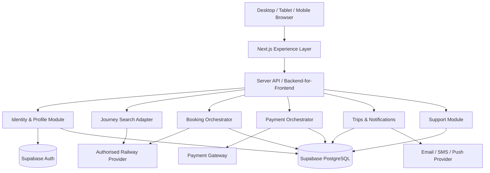

# RAILNOVA architecture plan

## Release-one topology

## Decisions

1. **Modular monolith first.** Keep a single deployable Next.js application with clear domain boundaries. Do not split into microservices before operational load or team ownership justifies it.
2. **Vercel is the web and API runtime.** Use Next.js route handlers for the backend-for-frontend, validation and provider adapters. Keep secrets in server-only environment variables.
3. **Supabase is the system of record.** Supabase Auth owns identity; PostgreSQL stores profiles, saved travellers, booking references, payment attempts, trip events, notifications and support requests. RLS scopes passenger-visible rows to `auth.uid()`.
4. **Railway provider boundary.** Search, live inventory, quote, booking, PNR, train-running status, platform, cancellation and ticket issuance are called only through an authorised provider adapter. Store provider references and source timestamps; do not seed synthetic services.
5. **Payment boundary.** Create orders server-side; verify signed webhooks server-side; reconcile provider status before changing booking state. Never store PAN/CVV or trust a client redirect as proof of payment.
6. **Duplicate protection.** Every booking/payment attempt carries an idempotency key. Database uniqueness constraints and provider idempotency protect retries; inventory holds must be transactional and expire safely.
7. **C++ boundary.** The supplied C++17 booking core is preserved under `engine/` with concurrency tests. Vercel's Next.js runtime does not host a long-running native C++ service. If profiling shows a need, deploy the engine as a separately operated container service; PostgreSQL remains authoritative.
8. **Motion and accessibility.** Use motion for state changes, not continuous decoration. Respect `prefers-reduced-motion`, keep keyboard focus visible, and use mobile-safe sticky navigation.

## Delivery phases

- **Phase 1 — Foundation:** responsive shell, navigation, visual system, Supabase schema, RLS and authentication wiring.
- **Phase 2 — Railway adapter:** station search, schedule/availability, current quote, freshness metadata and train detail.
- **Phase 3 — Booking:** passenger validation, idempotent request, transactional hold, provider confirmation and ticket reference.
- **Phase 4 — Payment:** provider checkout, signed webhooks, reconciliation, refund state machine and receipt.
- **Phase 5 — Travel-day operations:** PNR, running status, route stops, platform/delay events, notification delivery, food/support providers.
- **Phase 6 — Production hardening:** threat model, rate limits, audit review, load/concurrency tests, accessibility QA, monitoring, incident runbooks and compliance review.

## Current implementation status

- Responsive Next.js user interface: implemented.
- Splash, transitions, responsive desktop/mobile navigation and reduced-motion styles: implemented.
- Supabase browser authentication wiring: implemented but requires project URL/key and provider setup.
- PostgreSQL schema and RLS migration: prepared; not applied to a Supabase project yet.
- Railway provider, payment provider, notification delivery: not connected.
- No fabricated train, fare, PNR, booking or payment records are included.
- C++ test suite: passes locally; C++ runtime deployment remains separate from Vercel.
